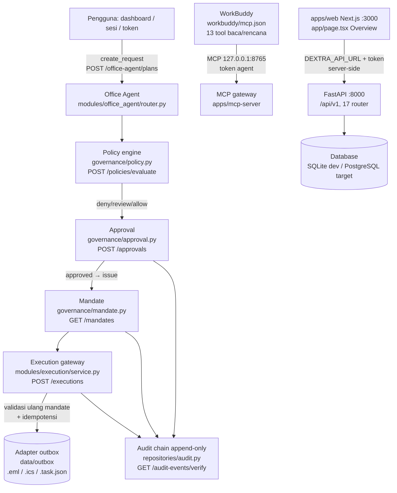

# DEXTRA — Governed AI Workforce untuk Kantor

**Tagline:** *Specialized AI workers. Human-defined authority. Accountable execution.*
(dari `README.md`)

DEXTRA adalah platform asisten operasional kantor yang merangkai AI Assistant, AI workforce, dashboard, dan kanal komunikasi dalam satu sistem yang tunduk pada tata kelola. Prinsip kerjanya tertulis satu baris di `README.md`: *baca boleh otomatis, tulis harus lewat mandat.*

Dokumen ini disiapkan untuk submission hackathon. Statusnya demo-ready, bukan production-ready. Batasan itu kami tulis terang-terangan di bawah, bukan diumpetin di footnote.

## Masalah

Pekerjaan kantor sehari-hari penuh tugas kecil yang kalau dikumpulkan memakan waktu: menyusun jadwal, meringkas percakapan, bikin draft laporan, meneruskan hasil ke manajer. Chatbot biasa bisa menjawab pertanyaan, tapi tidak bisa menyelesaikan pekerjaan itu secara terkontrol. Di sisi lain, kalau AI dibiarkan mengeksekusi tanpa batas, organisasi kehilangan kendali atas siapa yang menyetujui apa.

DEXTRA menjawab keduanya sekaligus. Pengguna bicara pakai bahasa biasa, misalnya "buatkan jadwal meeting besok pukul 10" atau "tolong periksa pekerjaan yang belum selesai" (contoh instruksi di `README.md`). DEXTRA lalu memecah permintaan jadi rencana, memeriksa kewenangan pengguna, dan hanya mengeksekusi setelah manusia menyetujui tindakan spesifik yang tertulis di rencana itu.

## Solusi: governed AI workforce

DEXTRA bukan kumpulan tool yang lepas. Inti produknya adalah rantai otorisasi yang ditegakkan server, bukan prompt:

```
token → scope → capability → tool → (governance) → mandate → eksekusi
```

Rantai itu ditulis di `README.md` §Model otorisasi, dan implementasinya ada di `backend/dextra/core/security.py` (`CAPABILITIES`, `SCOPE_CAPABILITIES`, `ROLE_CAPABILITIES`, `require_capability`) serta `backend/dextra/governance/` (`policy.py`, `mandate.py`, `approval.py`). Pemisahan token-nya konkret: scope `agent` hanya boleh baca, susun rencana, dan validasi rencana, sedangkan scope `ops` memegang approve, terbitkan/cabut mandat, eksekusi, dan baca audit log.

Di atas otoritas itu berdiri lima lapis governance yang semuanya punya endpoint nyata di FastAPI (`backend/dextra/main.py`, prefix `/api/v1`, 17 router):

- **Policy** (`POST /policies/evaluate`, `GET /policies`) — evaluasi deterministik lewat `governance/policy.py`, dengan reason code seperti `RECIPIENT_NOT_ALLOWED`, `AMBIGUOUS_RECIPIENT`, `OUTSIDE_OFFICE_HOURS`, `HOLIDAY_CONFLICT`, `FRIDAY_PRAYER_CONFLICT`, `BULK_EGRESS_SUSPECTED`, dan `INJECTION_QUARANTINED`. Masukan sama selalu menghasilkan keputusan sama, tanpa panggilan model.
- **Approval** (`POST /approvals`, `GET /approvals` di `modules/approvals/router.py`) — keputusan manusia yang mengikat satu `action_id` dan hash parameter. Approver yang tercatat adalah `principal_id` dari sesi/token terverifikasi, bukan string kiriman klien.
- **Mandate** (`GET /mandates`, `GET /mandates/{id}`, `POST /mandates/{id}/revoke` di `modules/mandates/router.py`) — kewenangan terbatas per aksi, dengan `params_hash`, `nonce`, `issued_at`, dan `expires_at` (default TTL 30 menit, dari `governance/mandate.py`).
- **Execution** (`POST /executions`, `GET /executions` di `modules/execution/router.py` + `service.py`) — validasi mandat diulang tepat sebelum aksi jalan, lalu cek idempotensi, baru eksekusi ke adapter `outbox` (file `.eml`, `.ics`, `.task.json` di `data/outbox`).
- **Audit** (`GET /audit-events`, `GET /audit-events/verify` di `modules/audit/router.py` + `repositories/audit.py`) — append-only dengan hash chain; tidak ada fungsi update/delete di repository-nya.

Dashboard di `apps/web/app/page.tsx` (Overview) menampilkan KPI yang dihitung backend (`GET /overview` di `modules/overview/router.py`): agen aktif, work package terbuka, approval menunggu, eksekusi gagal, mandat aktif. Kalau endpoint gagal, halamannya menampilkan banner "tidak tersedia" alih-alih angka contoh, sesuai komentar di `apps/web/lib/api.ts`.

## Alur demo end-to-end (6 langkah)

Urutan ini mengikuti komentar alur di `backend/dextra/modules/office_agent/router.py`, yang juga jadi jalur tombol Approve di UI (`approvePlanAction` di `apps/web/lib/api.ts`).

### 1. Mandate Input

Request masuk sebagai rencana Office Agent lewat `POST /office-agent/plans`. Payload-nya membawa `request_id`, `plan_id`, daftar `actions` (maks 50), `findings`, dan `validation`. Server menyimpan rencana per-tenant (`tenant_id` dari `require_tenant`), menolak `action_id` duplikat dengan 422, dan mengembalikan rencana yang sama bila `request_id` dikirim ulang — idempotensi di level rencana, bukan sekadar klaim.

### 2. Governance Validation

Sebelum ada yang disetujui, rencana melewati policy engine deterministik dan adversarial review. Policy endpoint `POST /policies/evaluate` butuh tenant aktif; caller tanpa tenant ditolak 400. Hasilnya berupa `decision` (`allow`/`deny`/`review`) plus `reason_code`. Di sisi WorkBuddy, skill `workforce-dispatcher` (`workbuddy/skills/workforce-dispatcher/SKILL.md`) mewajibkan rencana dikirim ke Adversarial Reviewer dan Policy Validator, dan melarang dispatcher mengeksekusi tindakan eksternal atau membuat approval/mandate sendiri.

### 3. AI Orchestration

Selama orchestration, agen tidak memegang kunci eksekusi. Paket `workbuddy/mcp.json` membatasi WorkBuddy ke 13 tool baca/rencana (`create_plan`, `validate_plan`, `get_plan`, `list_plans`, `get_mandate`, `list_mandates`, `list_executions`, dan sebagainya), dan catatan di file yang sama menegaskan token ops (`execute_action`, `submit_approval`, `issue_mandate`, `revoke_mandate`) tidak pernah diekspos ke agen. Empat spesialis yang ditetapkan di backend ada di `modules/workforce/router.py`: `workforce-dispatcher`, `executive-assistant`, `administrative-officer`, `adversarial-reviewer`.

### 4. AI Worker Execution

Eksekusi hanya terjadi lewat `POST /executions` dengan capability `execute`. Di `modules/execution/service.py`, urutannya tidak boleh dibalik: validasi mandat ulang, cek idempotensi pada kunci `mandate_id:action_id:params_digest`, jalankan aksi, catat hasil plus audit. Mandat yang dicabut, kedaluwarsa, atau parametrnya berubah sejak disetujui menghasilkan `action_blocked` dengan kode seperti `MANDATE_REVOKED`, `MANDATE_EXPIRED`, atau `PARAMS_CHANGED` (lihat `governance/mandate.py` → `validate_for_execution`). Adapter-nya `outbox`, bukan koneksi ke layanan eksternal.

### 5. Human Approval

Manusia menyetujui satu tindakan lewat `POST /office-agent/plans/{plan_id}/actions/{action_id}/approve` atau `POST /approvals`. Keduanya memakai satu implementasi yang sama, `governance/approval.py` → `record_decision`, supaya tidak ada jalur yang lupa menulis audit atau melupakan `tenant_id`. Persetujuan `approved` otomatis menerbitkan mandat yang terikat pada `action_id` dan `params_hash` itu, plus event audit `approval_recorded` dan `mandate_issued`. Keputusan `rejected` mengubah status rencana jadi `rejected`; yang disetujui sebagian jadi `partially_approved`. OPERATOR-MANUAL menambah satu lapis lagi: challenge code dicetak ke terminal backend, tidak pernah ke browser.

### 6. Result & Accountability

Hasil eksekusi tersimpan sebagai baris `Execution` dengan `status` (`succeeded`/`failed`/`running`), `duration_ms`, dan `result_json` berisi `result_id` serta path outbox. Setiap langkah menulis ke audit chain lewat `repositories/audit.py` → `append_event`, dengan `seq`, `prev_hash`, dan `entry_hash` (chain versi 2, termasuk `tenant_id` di hash). Verifikasi dilakukan lewat `GET /audit-events/verify`, yang mengembalikan `{ok, checked, broken_at_seq?}`. Overview di `apps/web/app/page.tsx` menutup lingkaran dengan menampilkan mandat aktif, antrean approval, dan audit terbaru dalam satu layar.

## Bukti demo (2026-11-06)

Bagian ini bukan janji. Semua ID di bawah hasil curl ke backend `:8000` dengan tenant `kenari` pada 2026-11-06, dan semua langkahnya selesai dengan status sukses. Catatannya kami simpan apa adanya, termasuk yang belum bisa kami buktikan.

**ID dan status yang terjadi.** `POST /api/v1/office-agent/plans` dengan `agent-dev-token` mengembalikan 201, `plan_id: pln_demo_20261106121723`, `plan_hash: c29c46cf...`, status `received`. Persetujuan lewat `POST /api/v1/office-agent/plans/{plan_id}/actions/{action_id}/approve` dengan `ops-dev-token` mengembalikan 201, `approval_id: apr_20261106051739_9437cdb0`, dan menerbitkan mandat `mnd_cd1a740e913176a9`. Eksekusi lewat `POST /api/v1/executions` mengembalikan 201, `execution_id: exe_1793942269804_1ea811`, status `succeeded`, provider `outbox`, `result_id: 9c9b742fa297450d9e28ebb2f08f4c69`. Terakhir, `GET /api/v1/audit-events/verify` mengembalikan 200 dengan `ok: true` dan `checked: 6`.

**Bukti.** Respons HTTP dan ID di atas adalah bukti primernya; file outbox lokal yang ditulis eksekusi itu tinggal di `data/outbox` sesuai adapter `outbox` di `modules/execution/service.py`. Untuk tangkapan layar dan rekaman, kami tidak mengarang. Path yang akan diisi lane screenshot tetap mengikuti placeholder di bagian Screenshot bawah, misalnya `docs/screenshots/S3-office-agent-detail.png` untuk detail rencana `pln_demo_20261106121723` dan `docs/screenshots/S7-audit.png` untuk hasil verify `checked: 6`. Selama file-file itu belum ada, jangan anggap screenshot sebagai bukti.

**Batas yang tetap berlaku.** `approver_id` pada approval di atas adalah `legacy:ops`, yaitu identitas token gateway lama, bukan nama manusia. Jadi demo ini membuktikan rantai plan → approve → mandate → execution → verify berjalan, tetapi belum membuktikan siapa manusia yang menekan approve. `outbox` juga bukan email yang terkirim; hasilnya file lokal, dan itu batas demo yang sudah kami tulis di bagian Batas demo. Untuk nama principal nyata, demo butuh sesi login manusia dengan role `approver`/`admin` supaya `approver_id` berasal dari sesi terverifikasi, bukan token. Perlu dibuktikan saat demo dengan sesi seperti itu.

## Diagram arsitektur



Catatan: diagram ini menggambarkan jalur governance yang benar-benar ada di kode. LLM tidak berada di jalur produksi governance; `governance/policy.py` menegaskan Policy Validator bukan agen AI dan tidak memanggil model.

## Kontribusi WorkBuddy

Bagian ini kami tulis jujur, karena ini yang paling mudah dilebih-lebihkan.

**Yang WorkBuddy bantu di pengembangan.** WorkBuddy dipakai sebagai asisten pengembangan: menyusun kode, menulis dan merevisi dokumen, serta menyiapkan skenario uji. Bukti yang bisa ditunjuk adalah berkas manifest di repo (`workbuddy/connector-meta.json`, `workbuddy/mcp.json`, `workbuddy/icon.svg`, `workbuddy/agents/*.md`, `workbuddy/skills/*/SKILL.md`, `workbuddy/knowledge/*.md`) dan dokumen uji `docs/WORKBUDDY-INTEGRATION-TEST.md`, yang mencatat status pengujian integrasi secara terbuka sebagai BELUM untuk kasus WB-01 sampai WB-06 karena pengujian langsung di WorkBuddy Desktop belum dilakukan.

**Yang WorkBuddy lakukan di dalam produk.** WorkBuddy hadir sebagai klien MCP dengan token `agent`. `workbuddy/mcp.json` mengarahkan koneksi ke `http://127.0.0.1:8765` dengan `allowedTools` yang hanya berisi tool baca dan rencana. Skill dan agen di paket itu (`workforce-dispatcher`, `executive-assistant`, `administrative-officer`, `adversarial-reviewer`, `policy-validator`) memberi peran dan batasan perilaku: dispatcher tidak boleh eksekusi, tidak boleh membuat approval/mandate, dan tidak boleh mengarang kebijakan. Penegakan batasnya tetap di server DEXTRA (`core/security.py`, `require_capability`), bukan di prompt WorkBuddy.

**Yang belum terbukti.** Koneksi langsung WorkBuddy Desktop ke gateway MCP belum diuji di sesi ini. Klaim "WorkBuddy terhubung live saat demo" perlu dibuktikan saat demo, dan `docs/WORKBUDDY-INTEGRATION-TEST.md` sudah menulis status itu sebagai BELUM. Kalau klien WorkBuddy tidak tersedia di panggung, bagian orchestration didemokan lewat API langsung dan UI, dengan catatan yang sama.

## Responsible AI & accountability

Responsible AI di DEXTRA bukan slogan. Wujudnya adalah penolakan yang bisa ditunjuk: policy engine menolak penerima di luar scope (`RECIPIENT_NOT_ALLOWED`) dan instruksi tersisip (`INJECTION_QUARANTINED`); mandat menolak parameter yang berubah (`PARAMS_CHANGED`); tenant mismatch menghasilkan 404 atau penolakan fail-closed, bukan akses global (`core/security.py` → `_bind_legacy_tenant`, `repositories/audit.py` → `list_events`). Accountability-nya ada di dokumen pendamping `docs/ACCOUNTABILITY-SHEET.md`, yang memetakan setiap tindakan agen ke mandat, tenant, role, permission, policy, approval, audit event, dan bukti executions, plus prosedur verifikasi lewat `GET /audit-events/verify`.

## Batas demo (bukan production-ready)

Bagian ini penting, jadi kami tulis singkat dan jelas. Eksekusi memakai adapter `outbox` dan executor mock yang tidak memanggil sistem eksternal (`README.md` §Modul non-prod, `modules/execution/service.py`); UI wajib memberi label mock. Telegram adapter masih TODO/post-MVP (`apps/telegram-adapter/`, `docs/CHANNEL-SETUP.md`), dan WhatsApp belum diimplementasikan sama sekali — `docs/CHANNEL-SETUP.md` menulisnya eksplisit sebagai post-MVP. PostgreSQL adalah target, tetapi migrasi dan tes di sesi pengembangan berjalan di SQLite karena PostgreSQL belum terpasang di mesin dev (`README.md`, `docs/DEPLOYMENT.md`). Google OAuth dicabut eksplisit dan mengembalikan 503 jujur. Semua klaim di atas bisa ditelusur ke berkas yang disebut, dan yang tidak bisa kami buktikan kami tandai "perlu dibuktikan saat demo".

## Link proyek

- Kode: `D:\dextra` (monorepo: `apps/web`, `apps/mcp-server`, `backend/dextra`, `workbuddy/`)
- Dokumen pendukung: `docs/ACCOUNTABILITY-SHEET.md`, `docs/DEMO-SCRIPT.md`, `docs/OPERATOR-MANUAL.md`, `docs/DEPLOYMENT.md`, `docs/IDENTITY_AUTHORIZATION_MODEL.md`
- Screenshot: lihat placeholder di bawah. Isinya diisi lane Playwright, bukan dibuat manual di dokumen ini.

## Screenshot (placeholder untuk lane Playwright)

| # | Layar | Path placeholder |
|---|---|---|
| S1 | Overview (`apps/web/app/page.tsx`, route `/`) | `docs/screenshots/S1-overview.png` |
| S2 | Office Agent — daftar rencana (`/office-agent`) | `docs/screenshots/S2-office-agent-plans.png` |
| S3 | Detail rencana + tombol approve (`/office-agent/[planId]`) | `docs/screenshots/S3-office-agent-detail.png` |
| S4 | Approval inbox (`/approvals`) | `docs/screenshots/S4-approvals.png` |
| S5 | Mandates (`/mandates`) | `docs/screenshots/S5-mandates.png` |
| S6 | Executions (`/executions`) | `docs/screenshots/S6-executions.png` |
| S7 | Audit trail + hasil verify (`/audit`) | `docs/screenshots/S7-audit.png` |

> Perlu dibuktikan saat demo: apakah semua route di atas menampilkan data nyata dari API pada lingkungan demo, atau sebagian menampilkan banner "tidak tersedia" karena endpoint belum terhubung. Jangan mengganti placeholder ini dengan tangkapan layar yang dibuat-buat.
